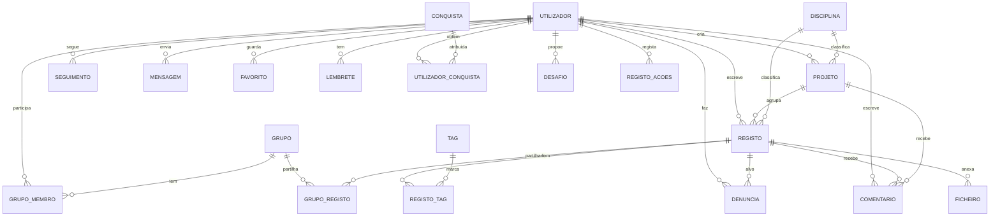

# BD Report — MyDay

Descrição da base de dados do MyDay e dos dados de exemplo. Este documento corresponde ao capítulo da base de dados do relatório final.

Ficheiros em `05_Artefactos/Base_Dados/`:

| Ficheiro | Conteúdo |
|---|---|
| `create.sql` | Cria a BD `myday`: 24 tabelas, 4 views, 5 triggers, 1 função e 2 stored procedures |
| `populate.sql` | Dados de exemplo coerentes (5 utilizadores, 7 registos, 4 projetos…) |
| `queries.sql` | 22 pesquisas que mostram a informação que se pode extrair |
| `criar_utilizador_app.sql` | Conta `myday` do MySQL usada pela API |

Descrição campo a campo: `dicionario_de_dados.md`.

## 1. Decisões de desenho

- **Privado por defeito.** `projeto.visibilidade` começa em `privado`. Em `registo.visibilidade`, o valor vazio quer dizer "segue a visibilidade do projeto"; um registo sem projeto fica privado. A view `v_registo` calcula a visibilidade efetiva com `coalesce(r.visibilidade, p.visibilidade, 'privado')`.
- **Amigos = seguem-se um ao outro.** Não há uma tabela de amizades: a relação sai da tabela `seguimento` (A segue B e B segue A).
- **Localização com privacidade.** Guardam-se as coordenadas exatas (só com `consent_localizacao`) e uma versão arredondada a 2 casas decimais (cerca de 1 km). O mapa e as pesquisas por local usam só a versão aproximada.
- **Sincronização offline.** `registo.uuid_cliente` é gerado no telemóvel. Assim, um registo criado sem rede não fica duplicado quando é enviado mais tarde.
- **Um alvo de cada vez.** Comentários, favoritos, destaques e denúncias apontam para um registo **ou** para um projeto (ou para um comentário, no caso das denúncias). Os triggers `trg_*_alvo` garantem isto. Não se usou `CHECK`, porque o MySQL não deixa usar numa `CHECK` colunas que têm `ON DELETE CASCADE`.
- **Apagar a conta apaga tudo.** As chaves estrangeiras para `utilizador` usam `ON DELETE CASCADE`. `sp_apagar_conta` remove a conta e, por arrasto, os registos, ficheiros, comentários e seguimentos.
- **Auditoria.** Cada ação de um administrador fica em `registo_acoes`, com detalhes em JSON.
- **Lembretes com mapa de bits.** `dias_semana` guarda os 7 dias num só número (1 = segunda … 64 = domingo). Por exemplo, 31 = dias úteis e 127 = todos os dias.

## 2. Modelo Entidade-Relação

Tabelas por área:

| Área | Tabelas |
|---|---|
| Utilizadores | `utilizador`, `seguimento`, `mensagem`, `utilizador_segue_tag`, `utilizador_segue_disciplina` |
| Conteúdo | `registo`, `ficheiro`, `projeto`, `disciplina`, `tag`, `registo_tag` |
| Interação | `comentario`, `favorito`, `grupo`, `grupo_membro`, `grupo_registo` |
| Hábito | `lembrete`, `conquista`, `utilizador_conquista` |
| Administração | `denuncia`, `desafio`, `destaque`, `registo_acoes` |
| Serviços externos | `cache_api` |

## 3. Objetos além das tabelas

| Objeto | Tipo | Para que serve | Usado em |
|---|---|---|---|
| `v_registo` | View | Registo com autor, projeto, disciplina e visibilidade efetiva | Toda a API |
| `v_feed_publico` | View | O que um convidado pode ver | `queries.sql` (3) |
| `v_estatisticas_utilizador` | View | Números do perfil | `GET /api/utilizadores/:id` |
| `v_denuncias_pendentes` | View | Fila de moderação | `GET /api/admin/denuncias` |
| `fn_dias_seguidos` | Função | Dias seguidos com pelo menos um registo | Perfil |
| `sp_tratar_denuncia` | Procedure | Aceita/rejeita uma denúncia numa transação, oculta o registo e regista a ação | `PATCH /api/admin/denuncias/:id` |
| `sp_apagar_conta` | Procedure | Apaga a conta e tudo o que lhe pertence | `DELETE /api/utilizadores/eu` |
| `trg_comentario_alvo`, `trg_favorito_alvo`, `trg_destaque_alvo`, `trg_denuncia_alvo` | Triggers | Um alvo de cada vez | Inserções |
| `trg_seguimento_proprio` | Trigger | Ninguém se segue a si próprio | Inserções |

## 4. Guia de Dados (dados de exemplo)

Os dados simulam um grupo de estudantes de química de faculdades de Lisboa, entre setembro e novembro de 2026.

### Pessoas

| id | Nome | Instituição | Papel | Notas |
|---|---|---|---|---|
| 1 | Inês Marques Carvalho | FCUL | estudante | A mais ativa: 3 registos, 1 projeto público, dona do grupo de laboratório |
| 2 | Tiago Ferreira Gomes | FCUL | estudante | Amigo da Inês (seguem-se um ao outro); projeto só para amigos |
| 3 | Beatriz Antunes | IST | estudante | Projeto privado; segue a Inês |
| 4 | Diogo Sequeira | FCT NOVA | estudante | Projeto público; segue a Inês e a Beatriz |
| 5 | Sofia Rebelo | — | administradora | Tratou a denúncia e destacou o projeto da Inês |

Todas as contas usam a palavra-passe de teste `myday123`.

### Relações que os dados mostram

- **Visibilidade:** com 4 projetos (2 públicos, 1 só amigos, 1 privado) dá para testar o que cada pessoa vê. A Inês vê os registos do Tiago (são amigos), mas não os da Beatriz (privados). Um convidado só vê os registos públicos.
- **Linha temporal:** os projetos têm registos em dias e horas diferentes (por exemplo, refluxo às 10:12 e destilação às 12:40 do mesmo dia).
- **Mapa:** 6 registos têm local em 3 sítios: FCUL (4), IST (1) e FCT NOVA (1). Um registo não tem local.
- **Multimédia:** 7 ficheiros (5 fotos, 1 vídeo de 27 s e 1 áudio de 48 s).
- **Comunidade:** 4 comentários (2 em registos, 2 numa conversa sobre um projeto), 3 favoritos, 1 grupo de estudo com 2 membros e 2 registos partilhados, e 3 mensagens (uma por ler).
- **Hábito:** 3 lembretes (dias úteis, todos os dias e um desligado), 3 conquistas e 4 já obtidas.
- **Moderação:** 1 denúncia rejeitada, 1 destaque, 2 ações no registo de ações e 1 desafio ativo em novembro.
- **Serviços externos:** 2 respostas de geocodificação em cache.

### Contagem por tabela

| Tabela | Linhas | Tabela | Linhas |
|---|---|---|---|
| utilizador | 5 | comentario | 4 |
| seguimento | 5 | favorito | 3 |
| mensagem | 3 | grupo / grupo_membro / grupo_registo | 1 / 2 / 2 |
| disciplina | 5 | lembrete | 3 |
| tag | 6 | conquista / utilizador_conquista | 3 / 4 |
| projeto | 4 | denuncia | 1 |
| registo | 7 | desafio / destaque | 1 / 1 |
| ficheiro | 7 | registo_acoes | 2 |
| registo_tag | 6 | cache_api | 2 |

## 5. Pesquisas (`queries.sql`)

As 22 pesquisas cobrem o que a app precisa e vários tipos de SQL:

| Tipo de SQL | Exemplos |
|---|---|
| JOIN com várias tabelas e GROUP_CONCAT | 1 (diário com tags e contagem de ficheiros), 17 (grupos) |
| Subconsultas e EXISTS | 2 (feed de amigos), 10 (popularidade), 11 (sugestões de quem seguir) |
| Funções de janela | 7 (percentagem por disciplina com `sum() over()`), 9 (linha temporal com `row_number` e `lag`) |
| UNION | 4 (pesquisa em registos e projetos), 11 |
| Agregação com HAVING | 14 (mensagens por ler) |
| Datas e horas | 6 (calendário), 13 (minutos até ler), 15 (lembretes de hoje), 20 (desafio ativo) |
| Operações bit a bit | 15 (`dias_semana & (1 << weekday())`) |
| JSON | 19 e 21 (`->>` para ler campos) |
| Views, funções e procedimentos | 3, 8, 19, 22 |

Todas foram corridas sobre os dados de exemplo sem erros.
