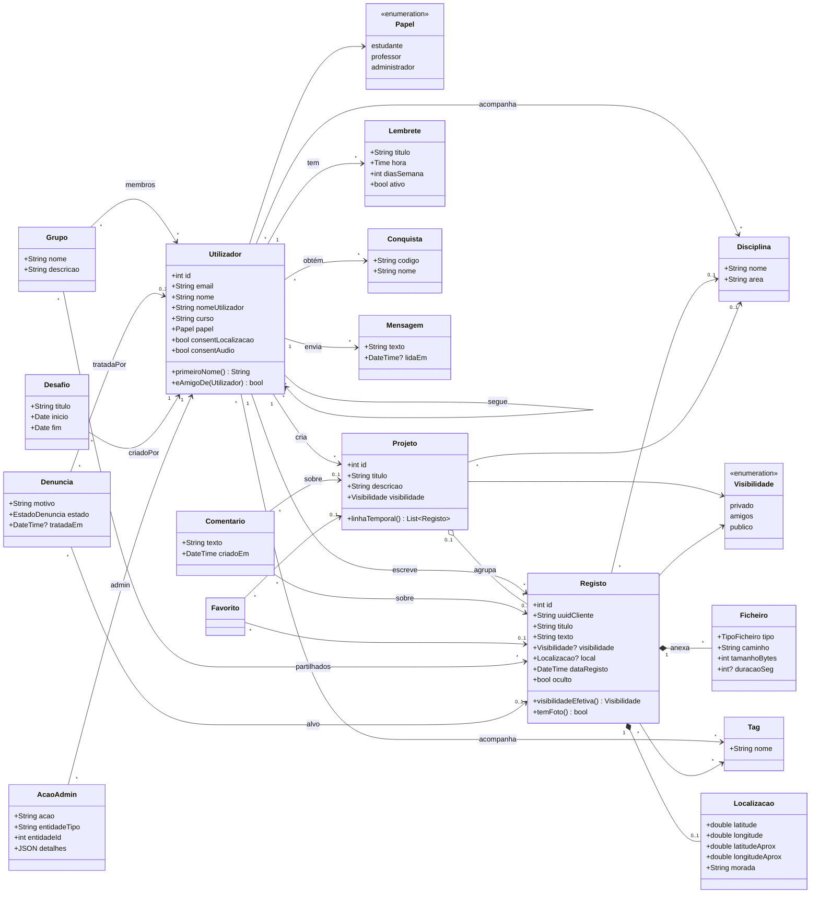

# Diagrama de classes (conceptual) — MyDay

Esboço das entidades do domínio e das relações entre elas. Os atributos são os mais importantes; a lista completa está no `dicionario_de_dados.md`.

## Notas

- **Visibilidade efetiva:** `Registo.visibilidadeEfetiva()` devolve a visibilidade do registo, senão a do projeto, senão `privado`. Na BD isto é a view `v_registo`.
- **Amigos:** `Utilizador.eAmigoDe(outro)` é verdadeiro quando os dois se seguem. Não há uma classe "Amizade".
- **Localização:** é uma parte do registo (composição). Só existe quando há consentimento.
- **Comentário, Favorito e Denúncia:** têm um único alvo (registo ou projeto), garantido pelos triggers da BD.
- **Na app Flutter**, estas entidades correspondem às classes de `lib/models/` (`Utilizador`, `Registo`, `Projeto`, `Comentario`, `Denuncia`, `Conquista`, `GrupoEstudo`, `AcaoAdmin`…). Os controllers de `lib/controllers/` guardam as listas e falam com a API através de `lib/data/myday_api.dart`.
