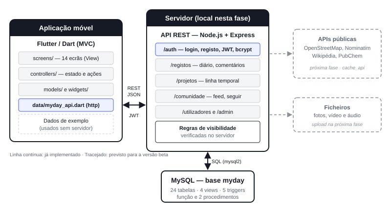
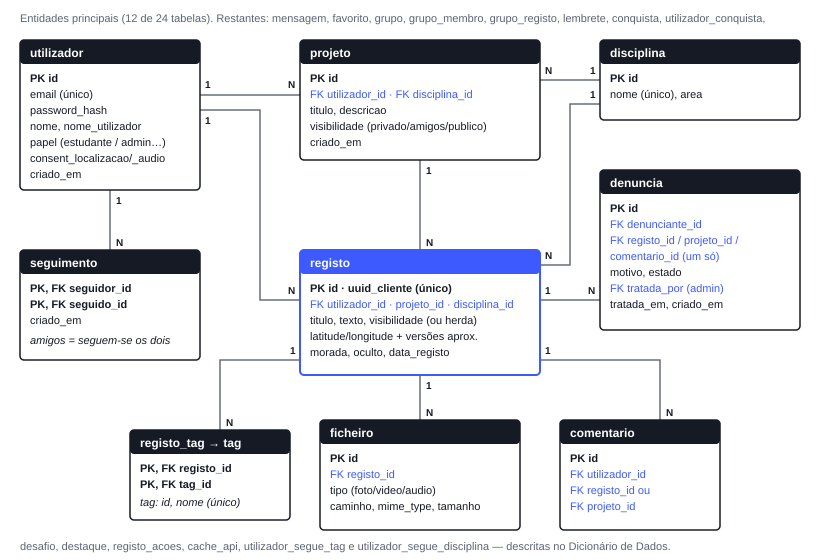
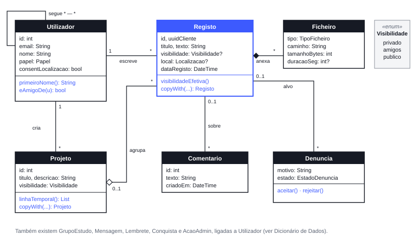
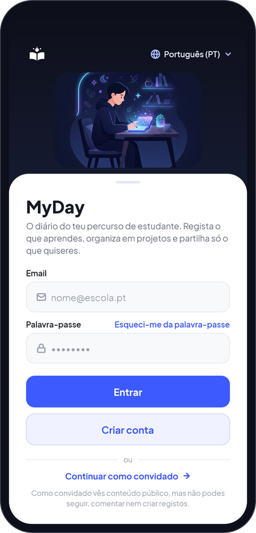
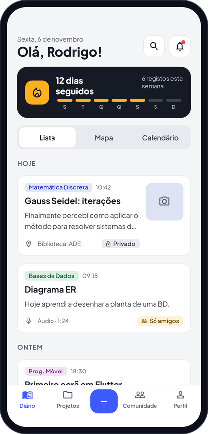
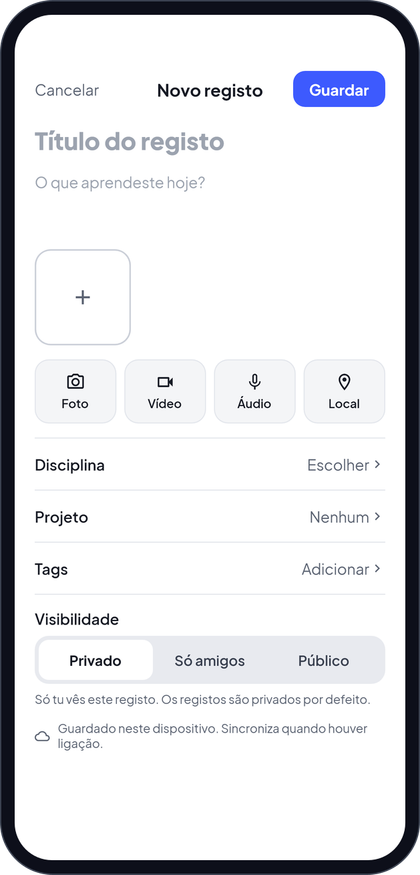
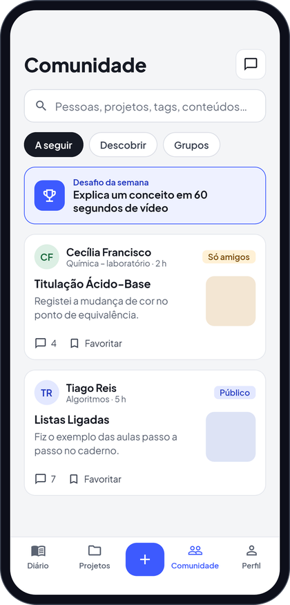
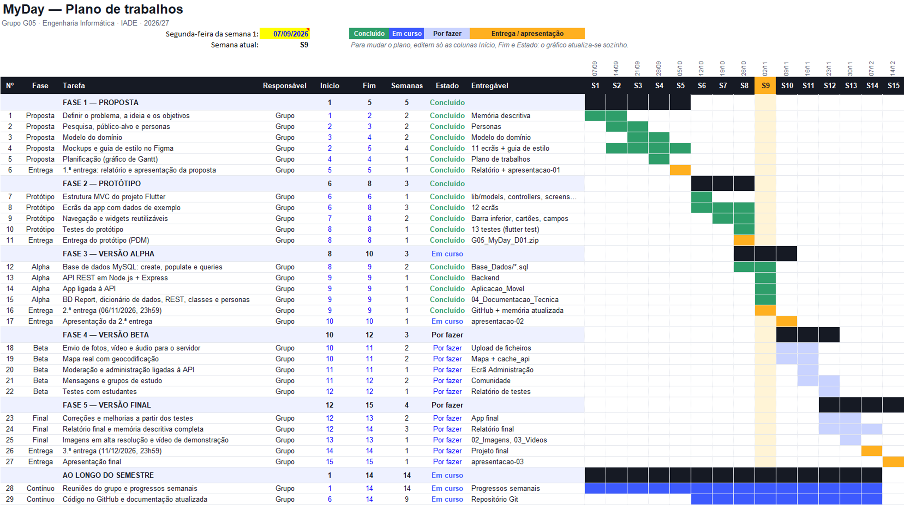

# MyDay (Diário de Experiências) — Relatório de Projeto Mobile

**2.ª entrega · versão alfa** · Licenciatura em Engenharia Informática · IADE – Universidade Europeia · Lisboa, novembro de 2026

> *«Volenti nihil difficile, sed nil volentibus arduum.»* (Para quem quer, nada é difícil; mas para quem não quer, tudo é árduo.) — Provérbio em Latim

## Índice

1. Identificação
2. Palavras-chave
3. Ponto de situação da 2.ª entrega
4. Descrição da aplicação e do problema que resolve
5. Objetivos e motivação
6. Público-alvo e personas
7. Pesquisa de mercado
8. Guiões de teste
9. Descrição da solução
10. Base de dados
11. Diagrama de classes
12. Documentação da API REST
13. Aplicação móvel (versão alfa)
14. Testes
15. Planeamento e calendarização
16. Conclusão
17. Bibliografia

## 1. Identificação

| | |
|---|---|
| **Universidade** | Universidade Europeia |
| **Faculdade** | IADE – Faculdade de Design, Tecnologia e Comunicação |
| **Curso** | Licenciatura em Engenharia Informática · 2026/2027 · 3.º semestre |
| **Projeto** | **MyDay** (Diário de experiências) |
| **Entrega** | 2.ª entrega — versão alfa (6 de novembro de 2026) |
| **Repositório GitHub** | https://github.com/Carla-Svbas/G05-MyDay- |
| **Design (Figma)** | https://www.figma.com/design/Z10SqibLprkXmmXoTZuEwg/G05_MyDay_D01?node-id=5-2 |

| Elemento do grupo | N.º de estudante |
|---|---|
| Carla Sebastião | 20251243 |
| Cristiano Zanzala | 20251017 |
| Lurdes Ferraz | 20251345 |
| Rodrigo Rodrigues | 20250480 |

## 2. Palavras-chave

Diário de aprendizagem; experiências; projetos; estudantes; rede de estudantes; aplicação móvel; Flutter; Node.js; Express; API REST; JWT; MySQL; geolocalização; APIs públicas; RGPD.

**Keywords:** Learning journal; students; mobile application; Flutter; Node.js; Express; REST API; JWT; MySQL; geolocation; Open APIs; GDPR.

## 3. Ponto de situação da 2.ª entrega

Desde a proposta inicial, o projeto passou por duas fases: um **protótipo** em Flutter com os ecrãs do Figma e dados de exemplo, e a **versão alfa** agora entregue, que junta a aplicação a um servidor e a uma base de dados reais.

| Componente | Proposta (1.ª entrega) | Versão alfa (2.ª entrega) |
|---|---|---|
| Design | Fluxos e protótipos em Figma | 11 ecrãs e guia de estilo concluídos no Figma |
| Aplicação móvel | Por desenvolver | 14 ecrãs em Flutter (MVC), navegação completa e ligação à API |
| Base de dados | Entidades principais identificadas | 24 tabelas, 4 views, 5 triggers, 1 função e 2 procedimentos em MySQL, com dados de exemplo |
| API | Planeada em Node.js | API REST em Node.js + Express, 30 rotas, autenticação por token JWT |
| Documentação | Relatório da proposta | BD Report, Dicionário de Dados, Guia de Dados, documentação REST, diagrama de classes, personas e guiões |
| Repositório | Criado | Organizado como pedido pela UC: `Aplicacao_Movel`, `Backend`, `Base_Dados`, `Apresentacoes` |

O que já funciona de ponta a ponta: entrar com uma conta da base de dados, ver o diário, a comunidade (com as regras de amigos) e os projetos, criar registos e comentar. Tudo é gravado no MySQL. O que ainda é simulado está indicado na secção 13.

## 4. Descrição da aplicação e do problema que resolve

O **MyDay** é um diário digital destinado a estudantes de qualquer instituição, com o objetivo de apoiar a documentação contínua de experiências, atividades e processos de aprendizagem. A aplicação permite registar momentos relevantes ao longo do tempo, combinando diferentes tipos de conteúdo (texto, fotografias, vídeo, áudio e localização), e organizá-los em projetos, de forma a representar não apenas o que foi feito, mas também como e porquê foi realizado.

Para além do registo individual, a aplicação contempla uma componente social: os estudantes podem seguir-se uns aos outros, guardar como favorito e comentar o que os colegas partilham, e criar grupos de estudo.

Um princípio que rege o sistema é a **privacidade**: tudo é **privado por defeito**, e cada projeto tem a sua visibilidade (privado, só amigos ou público). O utilizador controla sempre o que partilha e com quem.

O problema central que o MyDay resolve é o facto de os estudantes guardarem trabalho, ideias e aprendizagens em locais dispersos (notas, galeria, mensagens), o que dificulta rever o percurso e partilhá-lo com quem estuda o mesmo. O MyDay centraliza esse registo e permite partilhá-lo de forma controlada.

Principais funcionalidades:

- Registos com texto, fotografia, vídeo (duração limitada), áudio e localização opcional, com visualização no mapa.
- Projetos que agrupam registos, com visibilidade privada, só para amigos ou pública.
- Linha temporal, calendário e estatísticas pessoais (registos por semana, disciplinas mais trabalhadas, dias seguidos).
- Lembretes, dias seguidos e conquistas.
- Rede de estudantes: seguir, perfil, comentários, favoritos, seguir tags e disciplinas, grupos de estudo e mensagens diretas.
- Pesquisa de utilizadores, registos, projetos, tags e conteúdos de apoio ao estudante; partilha rápida de um perfil ou projeto por QR Code.
- Exportação de registos ou projetos selecionados para PDF.
- Administração: moderação de denúncias, estatísticas, gestão de tags e disciplinas, desafios, destaques, relatórios e registo de ações.

## 5. Objetivos e motivação

A motivação para o desenvolvimento do MyDay é dupla:

1. **Individual:** a aprendizagem tende a ser mais eficaz quando o estudante consegue visualizar e compreender o seu próprio percurso, o que favorece a reflexão e a monitorização da evolução.
2. **Comunitária:** partilhar o percurso com colegas que estudam o mesmo cria motivação, troca de ideias e uma comunidade de estudantes de várias instituições.

Adicionalmente, o projeto procura integrar, num único produto, os conteúdos de várias unidades curriculares, num contexto realista de engenharia e desenvolvimento de software.

### Objetivo geral

Desenvolver uma aplicação móvel para que estudantes registem experiências e processos de aprendizagem, os organizem em projetos e os partilhem de forma controlada, garantindo privacidade e conformidade com o RGPD, através de registo multimodal, organização e consulta de registos, componente social e uso de APIs públicas para funcionalidades complexas.

### Objetivos específicos

| Objetivo | Estado na versão alfa |
|---|---|
| Registar atividades e aprendizagens de forma rápida (texto e fotografia em menos de um minuto) | Registo de texto gravado no servidor; fotografia ainda simulada |
| Documentar projetos com texto, imagem, vídeo, áudio e localização | Estrutura na BD e na API; envio de ficheiros na versão beta |
| Organizar, pesquisar e consultar os registos ao longo do tempo | Diário, linha temporal, calendário e pesquisa na API |
| Partilhar projetos de forma privada, só com amigos ou pública, e exportá-los para PDF | Visibilidade aplicada no servidor; exportação PDF por fazer |
| Cumprir o RGPD: localização e áudio só com autorização; apagar registos e a conta | Consentimentos guardados, localização aproximada, apagar conta (procedimento) |
| Recorrer a APIs públicas e gratuitas para mapas e moradas | Tabela de cache preparada; integração na versão beta |

## 6. Público-alvo e personas

O MyDay destina-se a estudantes de qualquer instituição de ensino, sobretudo do ensino superior. Estão definidos três perfis:

- **Estudante:** utilizador autenticado; cria e gere os seus registos e projetos, segue e comenta outros estudantes e usa todas as funcionalidades sociais.
- **Convidado:** entra sem conta; consulta conteúdos públicos e usa a pesquisa, sem criar, editar ou eliminar.
- **Administrador:** gere utilizadores e conteúdos, modera denúncias e consulta as estatísticas da aplicação.

### Personas (definição final)

As personas correspondem às contas dos dados de exemplo da base de dados, o que permite testar os guiões com elas.

| Persona | Perfil | Objetivo | Frustração | Como usa o MyDay |
|---|---|---|---|---|
| **Inês**, 21 anos, 3.º ano de Química (FCUL) | Estudante | Guardar o que faz em cada experiência para escrever relatórios e preparar exames | Fotos na galeria, valores num caderno, áudios no WhatsApp | Cria um registo no fim de cada aula, organiza-os num projeto público e partilha no grupo do laboratório |
| **Tiago**, 22 anos, Química (FCUL) | Estudante | Comparar resultados com colegas e tirar dúvidas | Não quer publicar resultados para toda a gente | Projeto «só amigos», comenta os registos da Inês e troca mensagens |
| **Beatriz**, 20 anos, Eng. Química (IST) | Estudante | Ter um diário privado do trabalho de laboratório | Redes sociais expõem demasiado; não quer partilhar a localização | Projeto privado, sem consentimentos de localização e áudio |
| **Sofia** | Administradora | Manter a comunidade segura e motivada | — | Revê denúncias, destaca projetos e cria o desafio do mês |
| **Visitante** | Convidado | Perceber se a aplicação vale a pena | — | Vê apenas conteúdo público, sem criar, comentar nem seguir |

## 7. Pesquisa de mercado

Foram analisadas quatro aplicações conhecidas, duas de diário pessoal e duas de contexto escolar, com base na informação pública de cada serviço.

| Aplicação | Pontos fortes | Limitações face ao MyDay |
|---|---|---|
| **Day One** | Diário pessoal com fotografias, localização e boa organização das entradas | Uso individual; sem comunidade de estudantes nem projetos partilháveis por níveis de visibilidade |
| **Journey** | Diário multiplataforma com multimédia e sincronização | Sem componente social entre estudantes |
| **Seesaw** | Portefólios de aprendizagem com ligação entre alunos e professores | Pensada para escolas e turmas fechadas; menos centrada no diário pessoal e no mapa |
| **Google Classroom** | Distribuição e entrega de tarefas, integrada com ferramentas de produtividade | Não é um diário; a entrega é formal e o registo informal não é o foco |

As aplicações de diário servem o registo individual, mas não criam comunidades; as plataformas escolares servem a turma, mas tratam o registo como entrega formal. O MyDay posiciona-se entre as duas: um diário privado por defeito, em que o estudante decide se publica só para amigos ou para toda a comunidade.

## 8. Guiões de teste

Os guiões descrevem os fluxos que a versão final tem de suportar. Todos usam contas e dados fictícios (as contas dos dados de exemplo, com a palavra-passe de teste `myday123`). A coluna **Alfa** indica o estado de cada passo nesta entrega: ✔ funciona, ◐ funciona em parte ou de forma simulada, ✖ por fazer.

### CT-01 · Criar um registo com texto, fotografia e localização

**Ator:** Estudante (Inês). **Pré-condições:** conta criada; permissões de câmara e localização disponíveis.

| N.º | Ação do utilizador | Resultado esperado | Alfa |
|---|---|---|---|
| 1 | Iniciar sessão com as credenciais de teste | Ecrã inicial com a lista de registos | ✔ |
| 2 | Tocar em «Novo registo», escrever título e texto, e tirar uma fotografia | A fotografia surge em pré-visualização | ◐ |
| 3 | Ativar a localização | Pedido de autorização e, depois de aceite, morada (API Nominatim) anexada ao registo | ◐ |
| 4 | Guardar o registo | O registo aparece na lista como privado | ✔ |
| 5 | Abrir o mapa | Marcador do registo na posição correta | ◐ |
| 6 | Associar o registo a um projeto e passar o projeto a público | O projeto passa a ser visível a convidados, com a localização apenas aproximada | ✔ |

**Critério de sucesso:** registo gravado na base de dados com todos os campos, visível na lista e no mapa, em menos de um minuto. **Na alfa:** o registo é gravado no MySQL; a fotografia, a morada (fixa) e o mapa (desenhado) ainda são simulados.

### CT-02 · Partilha com amigos, comentários e favoritos

**Atores:** Estudante A (Tiago) e Estudante B (Inês). **Pré-condições:** o Estudante A tem um projeto «só amigos».

| N.º | Ação do utilizador | Resultado esperado | Alfa |
|---|---|---|---|
| 1 | B procura A e abre o perfil | O perfil mostra apenas os projetos públicos | ◐ |
| 2 | B segue A; A segue B | Os dois passam a ser amigos | ✔ |
| 3 | B abre os registos de A | O projeto «só amigos» passa a ser visível | ✔ |
| 4 | B comenta um registo e marca-o como favorito | Comentário visível; o registo surge nos favoritos de B | ✔ |
| 5 | A passa o projeto a privado | B deixa de ver o projeto e o comentário deixa de estar acessível | ✔ |

**Critério de sucesso:** fluxo completo sem falhas; o acesso a conteúdo privado é recusado pelo servidor. **Na alfa:** as regras de visibilidade são verificadas na API (resposta 404 a quem não pode ver) e testadas automaticamente; a pesquisa de perfis na app ainda não está ligada.

### CT-03 · Moderação de uma denúncia

**Atores:** Estudante e administrador (Sofia). **Pré-condições:** existe um registo público de outro estudante.

| N.º | Ação do utilizador | Resultado esperado | Alfa |
|---|---|---|---|
| 1 | Estudante denuncia o registo | A denúncia entra na fila de moderação | ✔ |
| 2 | Administrador abre a fila e oculta o registo | O registo deixa de ser visível ao público | ✔ |
| 3 | Administrador consulta o registo de ações | A ação fica registada com autor e data | ✔ |

**Critério de sucesso:** denúncia tratada e ação auditável. **Na alfa:** funciona na API (procedimento `sp_tratar_denuncia`); o ecrã de administração da app ainda usa dados de exemplo.

### CT-04 · Pesquisar, exportar para PDF e utilizar como convidado

**Atores:** Estudante e convidado. **Pré-condições:** pelo menos cinco registos criados, três com fotografia.

| N.º | Ação do utilizador | Resultado esperado | Alfa |
|---|---|---|---|
| 1 | Estudante pesquisa «derivadas» | Lista dos registos que contêm o termo | ◐ |
| 2 | Estudante seleciona três registos e toca em «Exportar para PDF» | PDF com os três registos | ✖ |
| 3 | Convidado entra sem conta e consulta registos públicos | Só aparecem registos públicos | ✔ |
| 4 | Convidado tenta seguir, comentar ou criar um registo | A ação é recusada | ✔ |

**Critério de sucesso:** PDF correto e permissões do convidado aplicadas no servidor, e não apenas na interface. **Na alfa:** a pesquisa existe na API; a exportação para PDF é feita na versão beta.

### CT-05 · Criar conta a partir do ecrã de entrada (novo)

**Ator:** Visitante. **Pré-condições:** o email ainda não tem conta.

| N.º | Ação do utilizador | Resultado esperado | Alfa |
|---|---|---|---|
| 1 | Escrever um email sem conta e tocar em «Entrar» | Mensagem «Não existe nenhuma conta com este email» | ✔ |
| 2 | — | Abre o ecrã «Criar conta» com o email já preenchido | ✔ |
| 3 | Preencher nome, curso e palavra-passe e criar a conta | A conta fica gravada (palavra-passe cifrada) e o utilizador entra no diário | ✔ |

## 9. Descrição da solução

### 9.1 Descrição genérica

A solução tem três partes: uma **aplicação móvel em Flutter/Dart**, uma **API REST em Node.js com Express** e uma **base de dados MySQL**. A interface foi desenhada em Figma seguindo as heurísticas de usabilidade de Nielsen.

A aplicação segue o padrão MVC: os modelos representam os dados, os controllers guardam o estado e chamam a API, e os ecrãs só desenham e reagem. Quando o servidor não está disponível, a aplicação continua a funcionar com dados de exemplo, o que permite demonstrá-la sem ligação.

A API valida a sessão com um **token JWT**, guarda as palavras-passe cifradas com **bcrypt** e aplica no servidor as regras de visibilidade (dono, público, só amigos e conteúdo oculto pela moderação).

Para abreviar o trabalho, as funcionalidades que não são o centro do projeto vão ser obtidas através de **APIs públicas e gratuitas**, sem chave de acesso, a integrar na versão beta:

- **OpenStreetMap** (mosaicos de mapa) para o mapa de registos.
- **Nominatim** para converter coordenadas em morada legível.
- **API REST da Wikipédia** para os conteúdos de apoio de Informática e Matemática.
- **PubChem (PUG REST)** como complemento opcional para Química.

Estas APIs têm limites de utilização (por exemplo, o Nominatim exige identificação da aplicação e não mais de um pedido por segundo). Por isso, os pedidos vão passar pela nossa API, que guarda as respostas na tabela `cache_api`.

### 9.2 Enquadramento nas unidades curriculares

| Unidade curricular | Contributo para o projeto |
|---|---|
| **Programação de Dispositivos Móveis** | Aplicação em Dart/Flutter: interfaces, navegação, gestão de estado (MVC com ChangeNotifier), consumo da API e regras de negócio. |
| **Bases de Dados** | Modelação relacional, esquema em MySQL, views, triggers, procedimentos e pesquisas (`create.sql`, `populate.sql`, `queries.sql`). |
| **Redes de Comunicação de Dados** | Comunicação HTTP/REST em JSON entre a aplicação e o servidor e consumo de APIs externas. O alojamento do servidor e o HTTPS ainda estão por definir. |
| **Interfaces e Usabilidade** | Fluxos e protótipos em Figma; guia de estilo; princípios de usabilidade. |
| **Matemática Discreta** | Implementar um dos métodos aprendidos nas aulas (por definir). |

### 9.3 Requisitos técnicos

#### Requisitos funcionais

| ID | Descrição | Prioridade | Estado (alfa) |
|---|---|---|---|
| RF01 | O sistema deve permitir o registo e a autenticação de utilizadores. | Alta | Implementado |
| RF02 | O sistema deve permitir a entrada como convidado, sem autenticação. | Alta | Implementado |
| RF03 | O estudante deve poder criar, consultar, editar e eliminar registos. | Alta | Parcial (editar por fazer) |
| RF04 | Cada registo deve poder incluir texto, fotografias, vídeo, áudio e localização. | Alta | Parcial (ficheiros simulados) |
| RF05 | O estudante deve poder agrupar registos em projetos. | Alta | Implementado |
| RF06 | Cada projeto deve ter visibilidade privada, só amigos ou pública. | Alta | Implementado |
| RF07 | O sistema deve permitir pesquisar utilizadores, registos, projetos, tags e conteúdos de apoio. | Alta | Parcial (registos) |
| RF08 | O estudante deve poder seguir outros utilizadores; quem se segue mutuamente é amigo. | Alta | Implementado |
| RF09 | O estudante deve poder consultar o perfil de outros utilizadores, com os projetos visíveis para si. | Média | Parcial (API) |
| RF10 | O estudante deve poder comentar registos e projetos a que tem acesso. | Média | Implementado (registos) |
| RF11 | O estudante deve poder guardar registos e projetos de outros como favoritos. | Média | Parcial (API) |
| RF12 | O estudante deve poder ver os registos num mapa e consultar a linha temporal e o calendário. | Média | Parcial (mapa desenhado) |
| RF13 | O sistema deve apresentar estatísticas pessoais, dias seguidos e conquistas. | Baixa | Implementado |
| RF14 | O estudante deve poder exportar registos ou projetos selecionados para PDF. | Média | Por fazer |
| RF15 | O estudante deve poder partilhar um perfil ou projeto por QR Code. | Baixa | Por fazer |
| RF16 | O estudante deve poder criar e participar em grupos de estudo com registos partilhados. | Baixa | Parcial (BD e API) |
| RF17 | Estudantes que se seguem devem poder trocar mensagens diretas. | Baixa | Parcial (BD) |
| RF18 | O sistema deve permitir registar sem ligação e sincronizar depois. | Baixa | Parcial (`uuid_cliente`) |
| RF19 | Qualquer utilizador autenticado deve poder denunciar conteúdo. | Média | Implementado (API) |
| RF20 | O administrador deve poder moderar denúncias, ocultar conteúdos e avisar ou suspender utilizadores. | Alta | Parcial (aceitar, rejeitar, ocultar) |
| RF21 | O administrador deve poder consultar estatísticas, gerir tags e disciplinas, publicar desafios, escolher destaques e exportar relatórios. | Média | Parcial (estatísticas) |
| RF22 | O sistema deve registar as ações administrativas para auditoria. | Média | Implementado |
| RF23 | O sistema deve impedir o convidado de seguir, comentar, favoritar ou criar conteúdo. | Alta | Implementado |

#### Requisitos não funcionais

- **Segurança:** autenticação por token (JWT), palavras-passe cifradas (bcrypt) e verificação de permissões no servidor — implementado. Comunicação por HTTPS — a configurar quando o servidor for alojado.
- **Desempenho:** índices nas pesquisas mais frequentes; o feed devolve no máximo 50 registos. Paginação completa na versão beta.
- **Usabilidade:** interface simples e consistente, com registo de uma experiência em poucos passos.
- **Fiabilidade:** criação de registos numa transação; chaves estrangeiras e triggers garantem a consistência dos dados.
- **Privacidade:** conteúdo privado inacessível a terceiros (o servidor responde 404); localização aproximada (cerca de 1 km) no conteúdo partilhado; tratamento de dados de acordo com o RGPD.
- **Custo:** utilização exclusiva de serviços e bibliotecas gratuitos.
- **Manutenibilidade:** código organizado por camadas (MVC na app, rotas na API), versionado no GitHub e documentado.

#### Tecnologias

| Componente | Tecnologia e finalidade |
|---|---|
| **Design de interfaces** | Figma: ecrãs, guia de estilo e protótipo. |
| **Aplicação móvel** | Dart com Flutter 3.13: interface, navegação e consumo da API (pacote `http`). |
| **Backend** | Node.js com Express 5: API REST, autenticação JWT (`jsonwebtoken`), cifra de palavras-passe (`bcryptjs`) e acesso à BD (`mysql2`). |
| **Base de dados** | MySQL: armazenamento relacional de utilizadores, projetos, registos, ficheiros, comentários, favoritos e restantes entidades. |
| **APIs públicas** | OpenStreetMap, Nominatim, Wikipédia e PubChem (versão beta). |
| **Servidor e redes** | Servidor local nesta fase; alojamento, rede e HTTPS por definir. |
| **Controlo de versões** | Git e GitHub: código, documentação e colaboração da equipa. |

### 9.4 Arquitetura

A arquitetura é cliente-servidor. A aplicação comunica com a API em Node.js através de pedidos REST em JSON, e é a API que tem acesso exclusivo à base de dados. Nesta fase, o servidor corre localmente; o alojamento e a configuração de rede ainda não estão definidos.



*Figura 1 – Arquitetura da versão alfa do MyDay*

### 9.5 Organização do repositório

O código está no GitHub, organizado como pedido pela unidade curricular:

| Pasta | Conteúdo |
|---|---|
| `05_Artefactos/Aplicacao_Movel` | Aplicação Flutter (`lib/models`, `lib/data`, `lib/controllers`, `lib/screens`, `lib/widgets`) e testes |
| `05_Artefactos/Backend` | API em Node.js + Express (`src/servidor.js`, `src/rotas/…`) e `testar_api.js` |
| `05_Artefactos/Base_Dados` | `create.sql`, `populate.sql`, `queries.sql` e `criar_utilizador_app.sql` |
| `05_Artefactos/Apresentacoes` | Slides de cada apresentação |
| `04_Documentacao_Tecnica` | BD Report, Dicionário de Dados, documentação REST, diagrama de classes, personas e guiões, plano de trabalhos e este relatório |

## 10. Base de dados

A base de dados `myday` foi construída em MySQL a partir dos dados de exemplo do grupo. O documento completo (BD Report) está em `04_Documentacao_Tecnica/bd_report.md`; aqui fica o resumo.

### 10.1 Modelo Entidade-Relação



*Figura 2 – Modelo Entidade-Relação (entidades principais)*

O registo é o centro do modelo: pertence a um utilizador, pode estar num projeto, tem uma disciplina, tags e ficheiros, e pode ser comentado, guardado como favorito ou denunciado. A relação de seguimento entre dois utilizadores define a amizade usada na visibilidade «só amigos».

### 10.2 Decisões de desenho

- **Privado por defeito:** se um registo não tiver visibilidade própria, segue a do projeto; sem projeto, fica privado. A view `v_registo` calcula a visibilidade efetiva.
- **Amigos = seguem-se um ao outro:** não há tabela de amizades; a relação resulta da tabela `seguimento`.
- **Localização com privacidade:** guardam-se as coordenadas exatas (só com consentimento) e uma versão arredondada a duas casas decimais (cerca de 1 km), a única usada no mapa e nas pesquisas.
- **Sincronização offline:** `uuid_cliente` é gerado no telemóvel, para um registo criado sem rede não ficar duplicado quando é enviado.
- **Um alvo de cada vez:** comentários, favoritos, destaques e denúncias apontam para um registo ou para um projeto; os triggers garantem isto.
- **Apagar a conta apaga tudo:** as chaves estrangeiras usam `ON DELETE CASCADE`.
- **Auditoria:** cada ação de administração fica em `registo_acoes`, com detalhes em JSON.

### 10.3 Objetos da base de dados

| Objeto | Tipo | Para que serve |
|---|---|---|
| `v_registo` | View | Registo com autor, projeto, disciplina e visibilidade efetiva |
| `v_feed_publico` | View | O que um convidado pode ver |
| `v_estatisticas_utilizador` | View | Números do perfil (registos, projetos, seguidores…) |
| `v_denuncias_pendentes` | View | Fila de moderação |
| `fn_dias_seguidos` | Função | Dias seguidos com pelo menos um registo |
| `sp_tratar_denuncia` | Procedimento | Aceita ou rejeita uma denúncia numa transação, oculta o registo e regista a ação |
| `sp_apagar_conta` | Procedimento | Apaga a conta e tudo o que lhe pertence |
| `trg_*_alvo` (4) e `trg_seguimento_proprio` | Triggers | Um alvo de cada vez; ninguém se segue a si próprio |

### 10.4 Dicionário de Dados (primeira versão)

O dicionário completo, com os 136 campos das 24 tabelas, está em `04_Documentacao_Tecnica/dicionario_de_dados.md`. Resumo das tabelas:

| Tabela | Descrição | Chaves estrangeiras |
|---|---|---|
| `utilizador` | Contas: estudantes, professores e administradores | — |
| `seguimento` | Quem segue quem (amigos = seguem-se os dois) | seguidor_id, seguido_id → utilizador |
| `mensagem` | Mensagens privadas | remetente_id, destinatario_id → utilizador |
| `disciplina` | Disciplinas para classificar registos e projetos | — |
| `tag` | Etiquetas livres | — |
| `utilizador_segue_tag` / `_disciplina` | Interesses de cada utilizador | → utilizador, tag / disciplina |
| `projeto` | Conjunto de registos sobre um tema | utilizador_id, disciplina_id |
| `registo` | Cada entrada do diário | utilizador_id, projeto_id, disciplina_id |
| `ficheiro` | Fotos, vídeos e áudios de um registo | registo_id |
| `registo_tag` | Tags de cada registo (N:N) | registo_id, tag_id |
| `comentario` | Comentários num registo ou projeto | utilizador_id, registo_id, projeto_id |
| `favorito` | Registos ou projetos guardados | utilizador_id, registo_id, projeto_id |
| `grupo`, `grupo_membro`, `grupo_registo` | Grupos de estudo, membros e registos partilhados | → utilizador, grupo, registo |
| `lembrete` | Lembretes (dias da semana num mapa de bits) | utilizador_id |
| `conquista`, `utilizador_conquista` | Conquistas e quem as obteve | → utilizador, conquista |
| `denuncia` | Denúncias de conteúdo | denunciante_id, registo_id, projeto_id, comentario_id, tratada_por |
| `desafio`, `destaque` | Desafios e destaques da administração | criado_por / escolhido_por, registo_id, projeto_id |
| `registo_acoes` | Histórico das ações de administração | admin_id |
| `cache_api` | Respostas de serviços externos em cache | — |

Detalhe da tabela principal, `registo`:

| Campo | Tipo | Chave | Nulo | Descrição |
|---|---|---|---|---|
| id | int unsigned | PK | não | Identificador do registo |
| uuid_cliente | char(36) | UQ | não | Identificador gerado no telemóvel, para sincronizar sem duplicar |
| utilizador_id | int unsigned | FK → utilizador | não | Autor |
| projeto_id | int unsigned | FK → projeto | sim | Projeto a que pertence |
| disciplina_id | int unsigned | FK → disciplina | sim | Disciplina |
| titulo | varchar(150) | | não | Título |
| texto | text | | sim | Descrição do que aprendeu |
| visibilidade | enum | | sim | Própria; vazio = herda a do projeto |
| latitude, longitude | decimal(9,6) | | sim | Posição exata (só com consentimento) |
| latitude_aprox, longitude_aprox | decimal(5,2) | | sim | Posição arredondada (~1 km), usada no mapa |
| morada | varchar(255) | | sim | Nome do local |
| oculto | boolean | | não | Ocultado pela moderação |
| data_registo | datetime | | não | Quando aconteceu |
| criado_em | datetime | | não | Quando foi gravado no servidor |

### 10.5 Guia de Dados (dados de exemplo)

Os dados simulam um grupo de estudantes de química de faculdades de Lisboa, entre setembro e novembro de 2026.

| Tabela | Linhas | Tabela | Linhas |
|---|---|---|---|
| utilizador | 5 | comentario | 4 |
| seguimento | 5 | favorito | 3 |
| mensagem | 3 | grupo / membros / registos | 1 / 2 / 2 |
| disciplina | 5 | lembrete | 3 |
| tag | 6 | conquista / obtidas | 3 / 4 |
| projeto | 4 | denuncia | 1 |
| registo | 7 | desafio / destaque | 1 / 1 |
| ficheiro | 7 | registo_acoes | 2 |

Os dados cobrem os casos que os guiões testam: quatro projetos com as três visibilidades, um par de amigos (Inês e Tiago), registos em três locais diferentes e um sem local, ficheiros de cada tipo, um grupo de estudo, mensagens lidas e por ler, uma denúncia tratada e um desafio ativo em novembro.

### 10.6 Pesquisas (`queries.sql`)

As 22 pesquisas mostram a informação que se pode tirar da base de dados e usam vários tipos de SQL: JOIN entre várias tabelas com GROUP_CONCAT (diário com tags e ficheiros), subconsultas e EXISTS (feed de amigos, sugestões de quem seguir), funções de janela (percentagem por disciplina, linha temporal com `row_number` e `lag`), UNION (pesquisa em registos e projetos), HAVING, datas, operações bit a bit (lembretes de hoje), JSON (registo de ações e cache) e chamadas às views, à função e aos procedimentos. Todas foram executadas sobre os dados de exemplo sem erros.

## 11. Diagrama de classes

Esboço conceptual das entidades e das relações entre elas. Na aplicação, estas entidades correspondem às classes de `lib/models/`.



*Figura 3 – Diagrama de classes (esboço)*

- `Registo.visibilidadeEfetiva()` devolve a visibilidade do registo, senão a do projeto, senão «privado».
- `Utilizador.eAmigoDe(outro)` é verdadeiro quando os dois se seguem.
- O losango cheio indica composição (os ficheiros só existem com o registo); o vazio indica agregação (o projeto agrupa registos que podem existir sem ele).

## 12. Documentação da API REST (primeira versão)

Endereço base: `http://localhost:3000/api`. Pedidos e respostas em JSON. As rotas protegidas exigem o cabeçalho `Authorization: Bearer <token>`, obtido no login. Os erros respondem sempre com `{ "erro": "mensagem" }` e o código HTTP adequado (400, 401, 403, 404, 409 ou 503). A documentação completa, com exemplos de pedidos e respostas, está em `04_Documentacao_Tecnica/documentacao_api.md`.

| Método | Rota | Acesso | Descrição |
|---|---|---|---|
| GET | `/saude` | Público | Estado do servidor e da BD |
| POST | `/auth/login` | Público | Entrar (devolve o token) |
| POST | `/auth/registar` | Público | Criar conta |
| GET | `/registos` | Sessão | O meu diário (filtros: disciplina, projeto, pesquisa) |
| GET | `/registos/:id` | Público/sessão | Detalhe, se o utilizador o puder ver |
| POST | `/registos` | Sessão | Novo registo, com tags e local |
| DELETE | `/registos/:id` | Sessão | Apagar um registo meu |
| POST | `/registos/:id/comentarios` | Sessão | Comentar |
| POST | `/registos/:id/favorito` | Sessão | Ligar ou desligar o favorito |
| POST | `/registos/:id/denuncias` | Sessão | Denunciar |
| GET | `/projetos`, `/projetos/:id` | Sessão / público | Projetos e linha temporal |
| POST, PATCH | `/projetos`, `/projetos/:id` | Sessão | Criar e editar projetos |
| GET | `/comunidade/feed` | Público/sessão | Feed «A seguir» ou «Descobrir» |
| POST | `/comunidade/seguir/:id` | Sessão | Seguir ou deixar de seguir |
| GET | `/utilizadores/:id` | Sessão | Perfil com estatísticas e conquistas |
| DELETE | `/utilizadores/eu` | Sessão | Apagar a conta (procedimento) |
| GET, PATCH | `/admin/denuncias…` | Administrador | Fila de moderação e decisão |
| GET | `/admin/acoes`, `/admin/estatisticas` | Administrador | Registo de ações e números gerais |

Exemplo — `POST /auth/login`:

```json
{ "email": "ines.carvalho02@gmail.com", "password": "myday123" }
```

Resposta `200`:

```json
{ "token": "eyJhbGciOiJIUzI1NiIs...",
  "utilizador": { "id": 1, "nome": "Inês Marques Carvalho", "curso": "Química", "papel": "estudante" } }
```

Se o email não tiver conta, a resposta é `404` com `"semConta": true`, o que permite à aplicação abrir logo o ecrã «Criar conta» (guião CT-05).

## 13. Aplicação móvel (versão alfa)

A aplicação tem 14 ecrãs em Flutter, organizados em MVC: `models` (classes de dados com `copyWith`), `data` (dados de exemplo e o serviço da API), `controllers` (estado com `ChangeNotifier`), `screens` (um ficheiro por ecrã) e `widgets` (componentes reutilizáveis, como cartões, campos, botões e a barra de navegação). A navegação usa a barra inferior (Diário, Projetos, +, Comunidade e Perfil) e o `Navigator` para os ecrãs de detalhe.

| | | | |
|---|---|---|---|
|  |  |  |  |
| Entrar | Diário | Novo registo | Comunidade |

*Figura 4 – Ecrãs da aplicação*

**O que já usa o servidor:** login e criação de conta, diário, comunidade (com as regras de amigos), projetos, novos registos e comentários.

**O que ainda é simulado:** câmara, microfone e envio de ficheiros; GPS e mapa real (o mapa é desenhado); exportação para PDF e QR Code; pesquisa, notificações e mensagens na aplicação; moderação no ecrã de administração (já existe na API).

## 14. Testes

| Tipo | Ferramenta | Resultado |
|---|---|---|
| Testes da API | `npm run testar` (25 verificações: login, visibilidade, registos, comentários, projetos, perfil e moderação) | 25 de 25 passam |
| Testes da aplicação | `flutter test` (13 testes dos controllers e do ecrã de entrada) | 13 de 13 passam |
| Análise estática | `flutter analyze` | Sem avisos |
| Pesquisas SQL | `queries.sql` sobre os dados de exemplo | 22 de 22 sem erros |
| Ponta a ponta | Entrar na app com uma conta da BD, criar um registo e confirmar a linha no MySQL | Funciona |

## 15. Planeamento e calendarização

Na proposta, o projeto estava planeado em 12 semanas, de 5 de outubro a 21 de dezembro. Na 2.ª entrega, o calendário foi **alinhado com as semanas do semestre** definidas pela unidade curricular: a semana 1 começou a 7 de setembro, a 2.ª entrega é no fim da semana 9 (6 de novembro) e a 3.ª no fim da semana 14 (11 de dezembro). O plano completo está em `04_Documentacao_Tecnica/plano_de_trabalhos.xlsx` e o diagrama de Gantt na Figura 5, no fim desta secção.

| Marco | Semana | Data | Estado |
|---|---|---|---|
| 1.ª entrega — proposta | S5 | 9/10/2026 | Concluído |
| Protótipo (PDM) | S8 | 30/10/2026 | Concluído |
| 2.ª entrega — versão alfa | S9 | 6/11/2026 | Concluído |
| Apresentação da 2.ª entrega | S10 | 13/11/2026 | Em curso |
| Versão beta | S10–S12 | — | Por fazer |
| 3.ª entrega — versão final | S14 | 11/12/2026 | Por fazer |

### Distribuição de tarefas

A distribuição por áreas definida na proposta mantém-se como referência:

- **Carla Sebastião:** Frontend.
- **Lurdes Ferraz:** Bases de Dados.
- **Rodrigo Rodrigues:** Backend.
- **Cristiano Zanzala:** Interfaces e Usabilidade.

Na prática, nesta fase todos os elementos participaram em todas as áreas, por isso no plano de trabalhos as tarefas estão atribuídas ao grupo. Todos participam nos testes e na redação do relatório.

### Riscos principais (revistos)

| Risco | Mitigação | Situação |
|---|---|---|
| Dependência de APIs externas (limites ou indisponibilidade) | Cache na nossa API e mensagens de erro claras | Tabela `cache_api` criada; integração na beta |
| Atraso na integração app–API | Definir cedo o contrato da API e testar com dados simulados | Resolvido: app ligada à API e modo sem servidor |
| Âmbito alargado (social e administração) | Fazer primeiro registos, projetos e visibilidade | Núcleo concluído; mensagens e grupos como incrementos |
| Complexidade do vídeo, do áudio e do mapa | Fazer primeiro texto e fotografia | Ficheiros e mapa real passam para a beta |
| Moderação e privacidade | Aplicar cedo as regras de visibilidade no servidor | Resolvido: regras na API e testadas |
| Alojamento do servidor ainda por definir | Servidor local e documentação de instalação | Por resolver até à versão final |



*Figura 5 – Plano de trabalhos e diagrama de Gantt (estado a 8 de novembro de 2026)*

## 16. Conclusão

O MyDay responde a uma necessidade concreta do meio académico: proporcionar aos estudantes um espaço único e privado por defeito para documentar o seu percurso, com a possibilidade de o partilhar de forma controlada com colegas de várias instituições.

Na 2.ª entrega, o projeto passou de proposta a uma versão alfa funcional: a aplicação Flutter está ligada a uma API em Node.js com Express e a uma base de dados MySQL, e as regras centrais do produto — privacidade por defeito, partilha com amigos e moderação — já são aplicadas no servidor e verificadas por testes automáticos.

Até ao final do semestre, os próximos passos são:

- **Versão beta:** envio de fotografias, vídeo e áudio; mapa real com geocodificação; moderação e administração ligadas à API; mensagens e grupos de estudo.
- **Validação com utilizadores:** testar a aplicação com, no mínimo, dois utilizadores reais e documentar as correções aplicadas.
- **Infraestrutura:** alojar a API e a base de dados num servidor, com HTTPS.
- **Consolidação:** entregar o repositório organizado, o relatório final e uma demonstração que comprove o cumprimento dos objetivos.

## 17. Bibliografia

Auth0. (s.d.). *Introduction to JSON Web Tokens*. https://jwt.io/introduction

Day One. (s.d.). *Day One Journal*. https://dayoneapp.com

Elmasri, R., & Navathe, S. B. (2016). *Fundamentals of database systems* (7.ª ed.). Pearson.

Express. (s.d.). *Express 5.x API reference*. https://expressjs.com/en/5x/api.html

Figma. (s.d.). *Figma help center*. https://help.figma.com

Google. (s.d.-a). *Dart documentation*. https://dart.dev/guides

Google. (s.d.-b). *Flutter documentation*. https://docs.flutter.dev

Google for Education. (s.d.). *Google Classroom*. https://edu.google.com/workspace-for-education/classroom/

Jones, M., Bradley, J., & Sakimura, N. (2015). *JSON Web Token (JWT)* (RFC 7519). IETF. https://www.rfc-editor.org/rfc/rfc7519

Journey. (s.d.). *Journey – Diary, journal*. https://journey.cloud

Kurose, J. F., & Ross, K. W. (2021). *Computer networking: A top-down approach* (8.ª ed.). Pearson.

Nielsen, J. (1994, 24 de abril). *10 usability heuristics for user interface design*. Nielsen Norman Group. https://www.nngroup.com/articles/ten-usability-heuristics/

OpenJS Foundation. (s.d.). *Node.js documentation*. https://nodejs.org/en/docs

OpenStreetMap Foundation. (s.d.-a). *Nominatim usage policy*. https://operations.osmfoundation.org/policies/nominatim/

OpenStreetMap Foundation. (s.d.-b). *Tile usage policy*. https://operations.osmfoundation.org/policies/tiles/

Oracle. (s.d.). *MySQL 8.0 reference manual*. https://dev.mysql.com/doc/refman/8.0/en/

Parlamento Europeu, & Conselho da União Europeia. (2016). Regulamento (UE) 2016/679 do Parlamento Europeu e do Conselho, de 27 de abril de 2016 (Regulamento Geral sobre a Proteção de Dados). *Jornal Oficial da União Europeia*, L 119, 1–88. https://eur-lex.europa.eu/eli/reg/2016/679/oj

Pinto, M., & Ribeiro, P. (2021). Avaliação de usabilidade e arquitetura de software em aplicações móveis. *Revista de Ciências da Computação, 16*, 45–62. https://doi.org/10.34624/rcc.v16i0.24150

Seesaw Learning. (s.d.). *Seesaw*. https://web.seesaw.me

Silva, J. F., & Martins, A. (2023). Testes automatizados e garantia de qualidade no desenvolvimento de software em Portugal. *Sistemas e Tecnologias de Informação, 28*(2), 101–118. https://doi.org/10.17013/risti.n28.101-118
